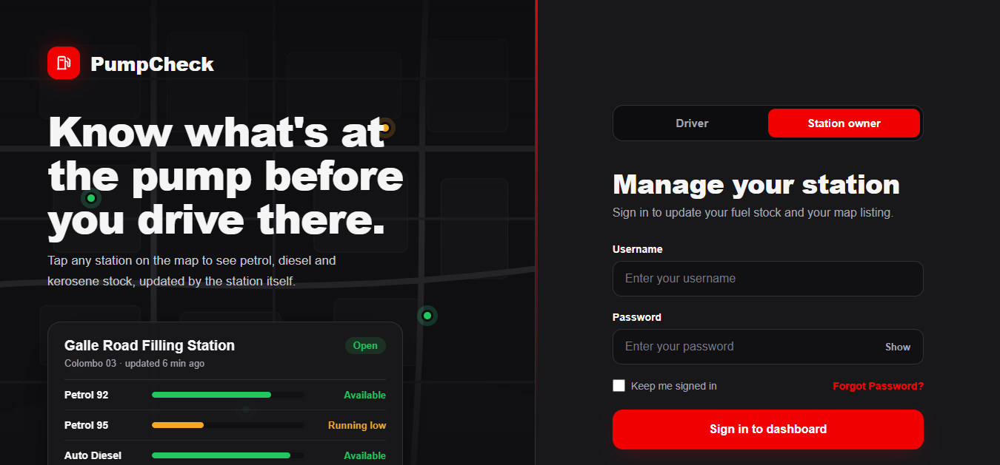
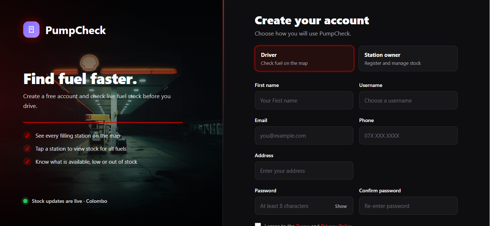
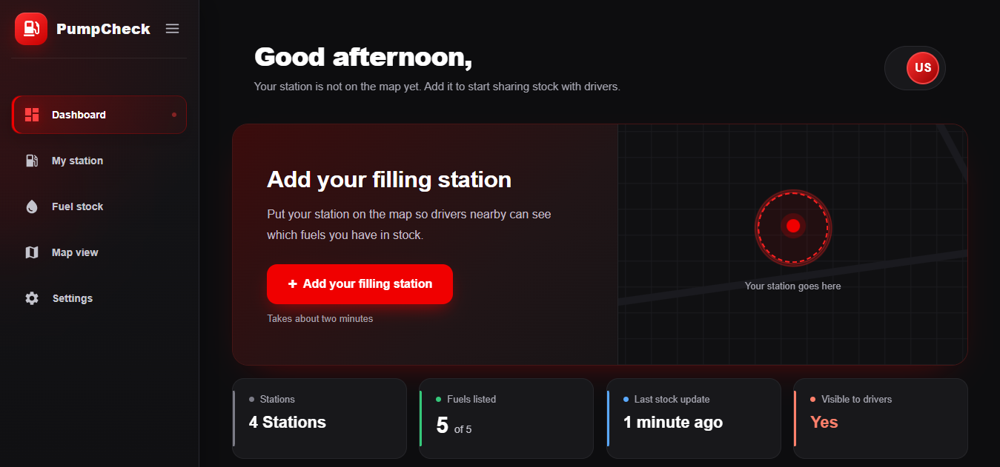
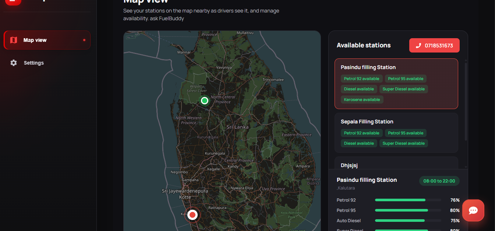
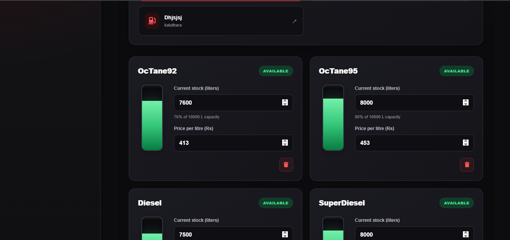
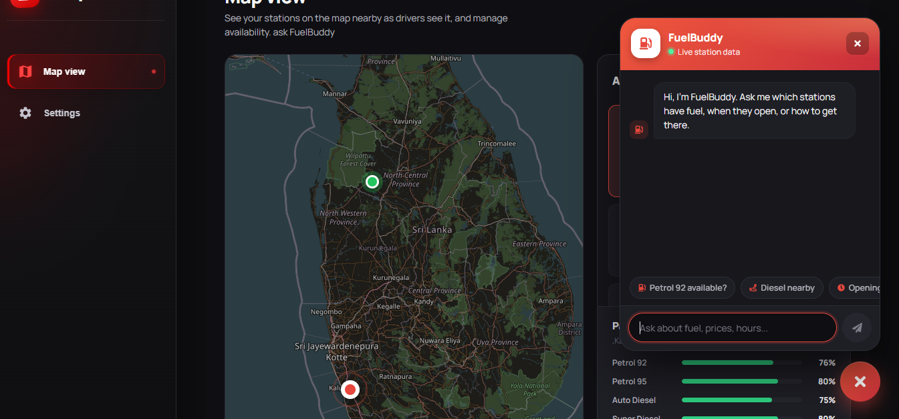

# PumpCheck – Fuel Availability System (Frontend)

PumpCheck is a web application that helps customers explore filling stations and view fuel availability in Sri Lanka. The frontend provides separate interfaces for administrators, customers and filling-station owners.

This repository contains the **React frontend** of the PumpCheck system. It communicates with the Node.js/Express backend through REST APIs.

## Live Application

- **Frontend:** https://fuel-availability-system-frontend-z-two.vercel.app
- **Backend API:** https://fuel-availability-system-backend.enzonic.dev

> Confirm that these deployment URLs are still active before submitting the project.

## Related Repository

- [Backend – Fuel Availability System](https://github.com/51241636/Fuel_availability_system_backend)

## Technologies and Tools

| Technology / Tool | Purpose |
|---|---|
| React | Building reusable user-interface components |
| TypeScript | Type-safe frontend development |
| Vite | Development server and build tool |
| React Router | Client-side routing and navigation |
| Axios | Sending HTTP requests to the backend |
| Tailwind CSS | Styling and responsive layouts |
| React Leaflet | Displaying interactive maps |
| Leaflet | Map functionality |
| OpenStreetMap | Map tiles and geographic information |
| React Icons / Material UI Icons | Interface icons |
| SweetAlert2 | Alerts and confirmation messages |
| Socket.IO Client | Client-side real-time communication support |
| fuel buddy ai |

## Main Features

### Authentication and Navigation
- User registration and login.
- Protected routes for authenticated users.
- Role-based navigation for Admin, Customer and Station Owner accounts.
- Access-token and refresh-token based authentication flow.
- Logout and password-recovery screens.

### Customer Features
- View filling-station locations on an interactive map.
- Explore station information and fuel availability.
- View fuel types and stock information supplied by station owners.

### Station Owner Features
- Add and manage filling-station information.
- Select a station location using the map.
- Manage fuel types, stock quantities, tank capacity and fuel prices.
- View fuel-stock summaries and availability statuses.

### Administrator Features
- Access the administrator dashboard.
- Manage and oversee system information through the available administrative functions.

### Payment and Profile
- Frontend payment flow for registration payment through PayHere.
- Profile information and profile-image display.
- Password recovery interface.

> **Real-time updates:** Socket.IO Client is included as a frontend dependency. Claim live stock updates only if the corresponding backend Socket.IO connection and events are implemented and enabled in the deployed system.

## Getting Started

### Prerequisites

Install the following:

- Node.js (LTS version recommended).
- npm.
- Git.
- A running instance of the PumpCheck backend, locally or remotely.

### 1. Clone the repository

```bash
git clone https://github.com/51241636/Fuel_availability_system_frontend.git
cd Fuel_availability_system_frontend
```

### 2. Open the frontend application directory

The Vite application is located in `filling_station_frontEnd`:

```bash
cd filling_station_frontEnd
```

### 3. Install dependencies

```bash
npm install
```

### 4. Configure the backend API URL

Create the environment file expected by the frontend (for Vite, commonly `.env` or `.env.local`). Set the API base URL using the exact variable name referenced by the frontend source code.

Example only:

```env
VITE_API_URL=http://localhost:3000
```

For production, configure the variable in the Vercel project settings to point to:

```text
https://fuel-availability-system-backend.enzonic.dev
```

> The variable name above is an example. Check the API configuration/service files in the source code and use the exact name expected by the application. Do not add private secrets to frontend environment variables because Vite variables are exposed to the browser.

### 5. Run the development server

```bash
npm run dev
```

Open the URL printed by Vite. The default Vite address is:

```text
http://localhost:5173
```

### 6. Build for production

```bash
npm run build
```

To preview the production build locally:

```bash
npm run preview
```

## Project Structure

The frontend application is inside `filling_station_frontEnd`. The following is a high-level guide; individual folders may differ in the current source:

```text
Fuel_availability_system_frontend/
└── filling_station_frontEnd/
    ├── public/
    ├── src/
    │   ├── components/
    │   ├── pages/
    │   ├── context/
    │   ├── services/
    │   └── ...
    ├── index.html
    ├── package.json
    ├── package-lock.json
    ├── tsconfig*.json
    └── vite.config.ts
```

## Screenshots

Add screenshots of the actual running application to `public/screenshots/`. Suggested filenames:

```text
public/
└── screenshots/
    ├── login.png
    ├── registration.png
    ├── admin-dashboard.png
    ├── customer-dashboard.png
    ├── station-owner-dashboard.png
    ├── fuel-stock-management.png
    ├── customer-map-view.png
    └── payment-page.png
```

When screenshots have been added, display them in this section:

### Login



### Registration



### owner Dashboard



### Customer Map view




### Fuel Stock Management




### fuel buddy ai



## Deployment

The frontend is deployed using Vercel.

For a new deployment:

1. Import the frontend GitHub repository into Vercel.
2. Set the project root directory to `filling_station_frontEnd` if Vercel does not detect the application directory automatically.
3. Configure the production API base URL using the environment-variable name expected by the source code.
4. Use the build command configured in `package.json` (typically `npm run build`).
5. Deploy and verify the live application.

Ensure the backend CORS configuration allows the deployed frontend origin.

## Author

**Pasindu Induvara Sepala**

- GitHub: https://github.com/51241636

## Related Project

The backend source code is available at:
https://github.com/51241636/Fuel_availability_system_backend
